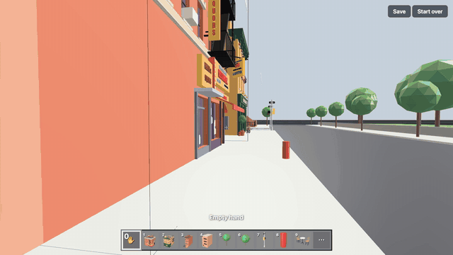
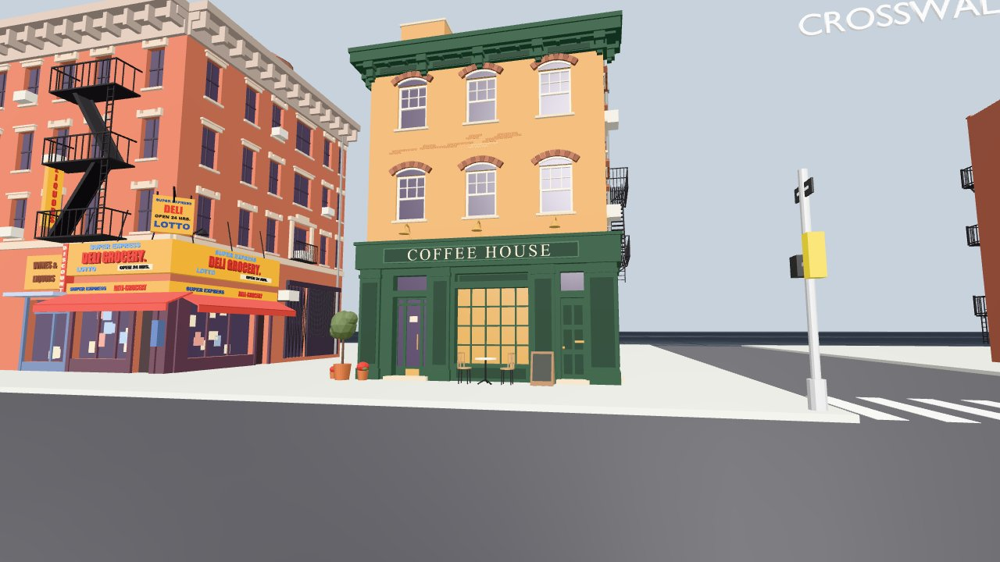

# Walk Viewer

**Walk through any 3D world like Minecraft, and let your AI find camera angles in it.**



I make film stills with AI images. Every shot happens on the same street, so the background has to match from shot to shot, and describing a camera angle in words never worked. So I stopped describing it and started showing it: the street is built once in 3D, I walk to the spot, look where the camera should look, and use that view as the reference.

Walk Viewer is that tool, in two parts:

1. **A website you walk through like Minecraft.** No 3D background needed.
2. **An MCP server for AI assistants** (Claude, Cursor, any MCP client). Your AI opens the same world, walks it, frames the shot you describe, and opens it in your browser so you can take over.

Try the website: **[walk-viewer.minho-portfolio.workers.dev](https://walk-viewer.minho-portfolio.workers.dev)** (desktop or phone)

## The website
| | Desktop | Phone |
|---|---|---|
| Look | Click the view, move the mouse (Esc lets go) | Drag on the right |
| Walk | W A S D · **W W** (keep holding) = run | Joystick on the left |
| Jump / fly | Space · **Space Space** = fly on/off | JUMP · FLY |
| Break (hold) | Hold click: a whole building, or just one part (a fire escape) | Hold a finger still |
| Place | Right click: snaps to a 1 m grid, its front turns to face you, green = fits | Tap |
| Pick a piece | 1–9 or scroll · 0 = empty hand · E = all pieces | Tap a slot |
| Keep it | **Save** (nothing changes for good until you press it) · Start over | Same |

Anything 4 m or wider opens in walking mode with gravity; smaller things (a 9 cm character) open in flying mode. Also: dolly zoom (hold Z + W/S), FOV and lens in mm on screen, a `?cam=x,y,z,yaw,pitch,fov` link parameter to share an exact view.

**Your own models:** drag `.glb` / `.gltf` files onto the page or use *Open model…* (from Blender, or AI 3D tools like Meshy, Tripo, Hunyuan3D, StoryArc). Files open in your browser only; nothing is uploaded. StoryArc floorplan `.json` files load too, and a floorplan plus prop `.glb` files rebuild the set.

**Breakable pieces:** any node with a `piece` custom property (glTF extras) becomes a breakable piece; a piece under another piece is a part of it. See [`make_sample.py`](make_sample.py), which builds the sample street in Blender.

### Run it yourself
Node 22+, nothing to install:
```
node serve.mjs                     # opens http://localhost:5240/ with the sample street
node serve.mjs /path/to/model.glb  # opens your model
```
(macOS: double-click `Open Walk Viewer.command`.) Or put the folder on any static host; `index.html` + `vendor/` + `models/` is the whole site.

## The MCP server: your AI walks the world


*Asked for "eye level, across the street from the coffee house, bodega on the left, 16:9", Claude opened the street, listed what was in it, moved the camera and opened this view in the browser: 6 tool calls.*

Add it to your assistant (needs Node 22+ and Google Chrome, or set `CHROME_PATH`):

**Claude Code**
```
claude mcp add walk-viewer -- node /full/path/walk-viewer/mcp/server.mjs
```
**Claude Desktop / Cursor / other MCP clients**
```json
{ "mcpServers": { "walk-viewer": { "command": "node", "args": ["/full/path/walk-viewer/mcp/server.mjs"] } } }
```

| Tool | Does |
|---|---|
| `open_world` | Open `.glb` / `.gltf` / StoryArc floorplan `.json` files by path or https URL. Returns size, start view and a picture |
| `list_objects` | Named objects with their centre and size in metres |
| `look` | A picture of the current view at any size (1920×1080, 1080×1920…) |
| `move_to` | Go to a point, or stand on the ground at eye height (1.7 m) |
| `walk` | Forward / right / up in metres; stops at walls and follows the floor |
| `turn` · `look_at` | Turn the head, or face a point or an object by name |
| `frame_object` | Fill the view with an object from the front, side, top or three-quarter |
| `what_is_at` | What's at a spot in the picture |
| `set_lens` | Field of view, or lens in mm (full-frame, like a Blender camera) |
| `open_in_browser` | Open the world in **your** browser at the AI's current view, so you walk on from there |

It runs on your computer: a hidden Chrome renders the same viewer, and a local web server (127.0.0.1 only) hands it only the files the AI opened. Units are metres, y is up.

## Files
`index.html` the whole viewer (three.js, no build step) · `vendor/three/` three.js r186 (MIT) · `serve.mjs` local server · `mcp/server.mjs` the MCP server · `make_sample.py` builds `models/sample-street.glb` in Blender · `assemble_set.py` rebuilds a StoryArc set (floorplan + prop GLBs) in Blender

## License
MIT. Made by [Minho Dong](https://minhodong.com).
